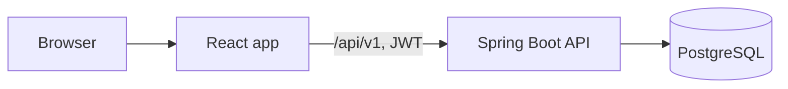

# PA Study Hub

[](https://github.com/SamaadTurner/pa-study-hub/actions/workflows/ci.yml)

A study app for physician assistant (PA) students: flashcards with spaced repetition,
timed practice exams in the style of the PANCE board exam, and a dashboard that tracks
streaks, daily goals and accuracy by topic.

**Try it: https://pa-study-hub.onrender.com** (register any email). It runs on free
plans, so after 15 minutes without visitors the server sleeps and the first page takes
about a minute to wake it up.

Spring Boot 3.2 (Java 17) and PostgreSQL 15 on the backend, React 18 with TypeScript on
the frontend. 451 backend tests, 143 frontend unit tests and 93 end-to-end browser tests (the main flows also in Safari's engine and on an iPhone screen)
run in CI on every push.


## What it does

- **Flashcard decks.** Create decks and cards, filed under 17 topics from the NCCPA
  exam blueprint (cardiology, pharmacology, and so on). Decks can be private or public.
- **Fill-in-the-blank cards.** Write a sentence with blanks in Anki's syntax,
  `{{c1::answer}}` or `{{c1::answer::hint}}` (or select words and press Make blank). Each
  blank number becomes its own card that hides only that blank, so each fact gets its own
  review schedule. The AI can suggest fill-in-the-blank cards too.
- **Picture cards.** Upload an anatomy diagram, an ECG strip or an X-ray and drag boxes
  over the parts to learn (or use Add box and the arrow keys). Every box becomes a card:
  the picture is shown with that box highlighted and the others covered, and revealing it
  uncovers the part and shows its label. Works with touch on phones. The boxes can be
  changed later: a box that is moved or relabelled keeps its card and study history.
- **Spaced repetition.** Studying a deck shows the cards that are due. You flip a card
  and rate it Again, Hard, Good or Easy, and the FSRS algorithm decides when it comes
  back; SM-2 can be switched back on (see [How cards are scheduled](#how-cards-are-scheduled)).
- **Public decks.** Search every public deck by title or description, filter by topic,
  and copy one into your own decks.
- **Practice exams.** Pick a topic, 5 to 30 questions and an optional time limit. You
  can skip and go back, and a reload keeps your answers and the time left. Right and
  wrong answers are only shown at the end, like the real exam, with an explanation for
  every question. An exam can also follow the PANCE blueprint mix (see below).
- **Your own questions.** Write multiple-choice questions with a patient scenario and an
  explanation. They are part of every exam you start, and you can share them. Questions
  other users shared are only used when you tick "Include questions other users shared",
  and the results page marks them as not checked and has a Report button. A shared
  question with 3 reports leaves other people's exams. Shared questions can be browsed by
  topic and searched, and the setup page shows how many questions each topic has.
- **Progress.** Daily goals for cards and minutes, a study streak, and an analytics page
  with 30 days of activity and accuracy by topic. Flashcards and exams both count.
  Exam results are also split by blueprint task, and the analytics page names your
  weakest one ("You miss pharmaceutical therapeutics questions 40% of the time").
- **Continue with Google.** Sign in or sign up with a Google account, or add Google to an
  existing account. Off unless the server has a Google client ID. A short
  [privacy page](https://pa-study-hub.onrender.com/privacy) says what is stored.
- **Forgot password and email confirmation.** A reset link by email (one hour, works once),
  and a confirmation link after signing up. A confirmed email lets Google sign-in link to the
  account without asking for its password.
- **Profile.** Change your details and password, set a password on an account made
  with Google, add or remove Google sign-in, and close your account, which deletes your
  data.
- **Optional AI help.** Paste notes and get suggested flashcards to review and edit
  before saving, or ask why your answer to an exam question was wrong. Off unless the
  server has an API key (see [AI features](#ai-features)).

| Studying a card | A practice exam question |
|---|---|
|  |  |

The app comes with 3 public decks and 30 practice questions (10 each for cardiology,
pharmacology and pulmonology). Exams in other topics say there are not enough questions
until you write your own.

## Run it

### With Docker

Needs Docker with Compose.

```bash
git clone https://github.com/SamaadTurner/pa-study-hub.git
cd pa-study-hub
cp .env.example .env
# Set JWT_SECRET in .env to 32 or more random characters, e.g. openssl rand -hex 32
docker compose up --build
```

Open http://localhost:3000 and register an account. The first start takes a few
minutes while the images build. CI runs these same steps on every push and registers
a user through port 3000, so this setup is tested.

### Without Docker

Needs JDK 17, Node 22.12 or newer and a PostgreSQL 15 database. The backend creates its tables
on first start.

```bash
# Backend on http://localhost:8080 (API docs at /swagger-ui.html)
DB_NAME=pa_study_hub DB_USER=postgres DB_PASSWORD=postgres \
SPRING_PROFILES_ACTIVE=dev ./gradlew :app:bootRun

# Frontend on http://localhost:5173, in a second terminal
cd frontend
npm install
npm run dev
```

`DB_HOST` and `DB_PORT` default to `localhost` and `5432`. The `dev` profile is for your
own machine only: it creates a demo account (`demo@example.com` / `DemoStudent1!`) and
uses a built-in JWT secret. Without it there is no demo account, and the backend will
not start until `JWT_SECRET` is set.

## Tests

```bash
# Backend tests on an in-memory H2 database, then the coverage check
./gradlew :app:test :app:jacocoTestCoverageVerification

# The same tests against PostgreSQL, with the schema built by the real migrations.
# This wipes the database, so point it at an empty one.
TEST_DATABASE=postgres TEST_DB_URL=jdbc:postgresql://localhost:5432/pa_study_hub_test \
TEST_DB_USERNAME=postgres TEST_DB_PASSWORD=postgres ./gradlew :app:cleanTest :app:test

# Frontend unit tests and lint
cd frontend && npm test && npm run lint

# End-to-end tests in Chromium. Only PostgreSQL has to be running: the tests start
# the backend and the frontend themselves (DB_* variables as above).
cd frontend && npx playwright install chromium && npm run e2e
```

- **Backend:** 451 tests. Unit tests for the scheduling, scoring and streak logic, and
  integration tests that call the API through Spring's MockMvc. CI runs them twice, on
  H2 and on PostgreSQL 15 with the Flyway migrations, so the SQL is tested too.
  They cover 96.6% of lines and 86.4% of branches (JaCoCo, without the code Lombok
  generates). The build fails below 95% and 78%.
- **Frontend:** 143 unit tests with Vitest and React Testing Library.
- **End to end:** 93 Playwright tests in Chromium; the account, deck, study, exam, fill-in-the-blank and picture card tests (49) also run in WebKit (desktop Safari) and on an iPhone 13 screen. They click through the real app: accounts (including sign-out, the login lock, the Google sign-in screens, the profile page, and the reset and confirmation links read from a dev-only outbox), decks
  and cards, studying, exams (including the timer running out), writing questions, public decks,
  analytics, the AI buttons (with the model's answers faked), and lists of more than 100
  decks and cards.
- **Accessibility:** axe checks every main page against WCAG 2.1 A and AA rules in the
  end-to-end suite (`accessibility.spec.ts`). Keyboard and screen reader use still needs a
  person to check.
- **Load test:** k6 (`perf/`), run by hand against a local backend; results under
  "One query for a whole deck list".
- **CI** has four jobs: backend tests, frontend tests with lint and build, end-to-end
  tests, and a Docker Compose run of the whole stack.

## How it is built



One Spring Boot application with a package per area (`user`, `flashcard`, `exam`,
`progress`) and one PostgreSQL database. The React app talks to it over a REST API at
`/api/v1`. In development Vite forwards `/api` to the backend, and in Docker nginx does.

```
app/                     Spring Boot backend
  src/main/java/com/pastudyhub/
    user/                accounts, login, JWT
    flashcard/           decks, cards, scheduling (SM-2)
    exam/                questions, exams, scoring
    progress/            activity log, streaks, goals, analytics
  src/main/resources/db/migration/   Flyway SQL migrations
frontend/                React + TypeScript + Vite + Tailwind
  src/pages/             one folder per area
  e2e/                   Playwright tests
docker-compose.yml       PostgreSQL, backend and nginx with the frontend
```

### How cards are scheduled

Each card keeps an interval (days until it is due), a repetition count and an ease
factor that starts at 2.5. The four buttons send a quality from 1 to 5: Again is 1,
Hard 2, Good 4 and Easy 5. With 3 or more, the card comes back after 1 day, then 6
days, then the last interval times the ease factor. Below 3, it starts over at 1 day.
The ease factor goes up after an easy answer and down after a hard one, never below
1.3. This is the SM-2 algorithm from SuperMemo, the same idea Anki started from. The
code is in `SpacedRepetitionEngine.java`.

There is also **FSRS-6**, the newer scheduler Anki offers since 2023. Instead of an ease
factor it tracks each card's *stability* (days until the chance of remembering drops to
90%) and *difficulty*, and plans the next review for the day that chance reaches the
target (90% by default). `FsrsEngine.java` is a port of the official TypeScript
implementation (ts-fsrs), and its tests compare every step of several review sequences
with numbers printed by that implementation.

Both schedulers run on every review and keep their own numbers, and every review is
logged (`review_logs`). `SCHEDULING_ALGORITHM=sm2` or `fsrs` decides whose date is used,
so switching never loses a card's history. FSRS has been the default since it was
measured against SM-2 on real review histories (results below).

### Comparing the schedulers

`src/evaluation` is a small command-line tool (kept out of the app's jar) that replays
review histories and scores both schedulers the way the public
[spaced-repetition benchmark](https://github.com/open-spaced-repetition/srs-benchmark)
does. Before every review except a card's first, each scheduler predicts the chance the
card is remembered; then it is shown the real rating (anything but Again counts as
remembered). Three scores come out:

- **Log loss:** how surprised the scheduler was on average. Lower is better.
- **RMSE (bins):** calibration. Predictions are grouped in 10% bins and each bin's average
  prediction is compared with how often those cards really were remembered. Lower is better.
- **AUC:** ranking only. 0.5 is guessing, 1 is perfect.

FSRS predicts recall directly. SM-2 only picks intervals, so to score it the tool assumes
what SM-2 aims for: 90% recall on the day its interval ends, falling off exponentially
(`0.9 ^ (days / interval)`). SM-2's scores depend on that assumption.

```bash
# reviews.csv has a header and the columns card_id,day,rating (rating 1 to 4)
./gradlew :app:evaluateSchedulers --args="path/to/reviews.csv"
```

**Results (2026-11-15).** The data is 10 users from the public
[anki-revlogs-10k](https://huggingface.co/datasets/open-spaced-repetition/anki-revlogs-10k)
dataset: 507,273 Anki reviews of 88,156 cards, of which 298,661 reviews could be predicted
(the first review of each card, and extra reviews on the same day, are skipped). The
dataset's license does not allow sharing the data, so only the scores are here. FSRS uses
its default parameters, not ones fitted to each user.

| Scheduler | Log loss | RMSE (bins) | AUC |
|---|---|---|---|
| SM-2 | 1.217 | 0.288 | 0.558 |
| FSRS-6 | **0.557** | **0.108** | **0.749** |

FSRS is better on all three across the pooled reviews. AUC is the fairest of the three for
SM-2, because it only depends on the order of the predictions, so it does not rest on the
90% assumption above; SM-2 is only a little better than guessing at telling which cards
will be forgotten. Scored user by user, FSRS has the better log loss and RMSE for 8 of the
10 users and the better AUC for 9 of 10. For the two users where SM-2 did slightly better,
FSRS with parameters fitted to their own history would be the next thing to try.

## Decisions

**From six services to one app.** The first version was six Spring Boot services
(gateway, users, flashcards, exams, progress and an AI assistant) with five databases.
For one app with a handful of users that was mostly overhead: features that crossed two
services needed HTTP calls between them and could not share a transaction. In July 2026
I merged them into one application with one database. One of those HTTP calls survived
the merge and pointed at a service that no longer existed, so reviews never reached the
streak counter until I replaced it with a plain method call in the same transaction.
The packages still follow the old service lines, so splitting one out later would be
possible.

**JWT with refresh tokens.** Access tokens last 15 minutes and are checked without a
database lookup. Refresh tokens are stored, work once, and are replaced on every use.
If an old one is used again, every token of that account is revoked, because that
usually means someone copied it. Changing the password revokes the refresh tokens too.
The refresh token is never given to the page's JavaScript: every response that signs
someone in moves it into an `HttpOnly`, `Secure`, `SameSite=Strict` cookie that is only
sent to `/api/v1/auth` (`RefreshTokenCookieAdvice`), so a script that got into the page
could not carry a session away for a week. The 15-minute access token stays in
`localStorage`. Students who were signed in before the change hand their old stored
token over once and get the cookie, without signing in again.

**Security headers on the site.** The static site sends a Content-Security-Policy (scripts
only from the site itself and Google's sign-in script, no `eval`, no plugins, no framing
by other sites), `X-Frame-Options: DENY`, `nosniff`, a referrer policy, HSTS and
`Cross-Origin-Opener-Policy: same-origin-allow-popups` (what Google's sign-in popup needs).
The values live in `frontend/security-headers.json`; `render.yaml`, the Docker nginx and
`vite preview` carry copies, and a unit test fails if a copy drifts. The production build
was walked through under the policy (sign-in button, charts, pictures, fonts) with nothing
blocked, and the Docker smoke test in CI checks the headers are sent.

**Sign-ups are capped for the whole site.** At most 30 new accounts an hour and 200 a day
(`SignupLimiter`, counted from `users.created_at`). Each new account sends a confirmation
email and the free Brevo plan sends 300 a day, so a script making accounts could otherwise
stop password reset emails for everyone. Like the login lock it is not per IP address, for
the reason below; people who already have an account are not affected. So that a script
can't simply use the cap up and pause sign-up for everyone, the sign-up form has a bot check:
Cloudflare Turnstile (free), which most people pass without a click. The browser gets a
one-time token and the server confirms it with Cloudflare before anything else (`BotCheck`),
so a script learns nothing, not even whether an email is taken, without passing it. It is
off when the keys are not set, so local runs, the tests and Docker need no Cloudflare
account; it was checked in a real browser with Cloudflare's test keys under the site's
Content-Security-Policy. Google sign-up skips it, since Google already checks the person.

**The access token stays in `localStorage`, on purpose.** Keeping it only in memory would
mean every open tab refreshes on its own, on load and every 15 minutes, all with the one
refresh cookie. The server rotates that token and treats reuse as theft, so two tabs
refreshing at the same moment would sign the student out everywhere. A script that got into
the page could make requests as the student either way; what limits the damage is the
Content-Security-Policy (no outside or inline scripts) and the refresh token being out of
reach, which caps a stolen access token at 15 minutes.

**Tests against real PostgreSQL.** The H2 run is fast, but H2 builds its tables from the
Java classes and never runs the migration files. On PostgreSQL the schema comes from the
migrations and Hibernate checks at startup that every class matches its table, so a
migration that does not fit the code fails CI.

**Exams can follow the PANCE blueprint.** NCCPA's 2025 blueprint sorts questions two
ways: by organ system, and by the task being tested (history and physical 16%,
diagnostic studies 10%, most likely diagnosis 18%, health maintenance 11%, clinical
intervention 16%, pharmaceutical therapeutics 15%, basic science 8%, professional
practice 6%). Every question has a task area, and an exam started with the blueprint
option gets the same mix. The number of questions per area is worked out with the
largest remainder method, so a 10 question exam still adds up to 10. When an area has
too few questions (the starter bank has no professional practice questions), the
missing places are filled at random from the rest. `BlueprintSelector` does the picking
and has its own unit tests. Results are scored per task area too, and the totals over all
exams come from one grouped query. The weakest task is only named once it has at least
5 questions, so one wrong answer in a small area does not look like a weakness.

**Exams are stored question by question.** The questions an exam picked are saved when it
starts, in order, with the order of their answer options fixed per exam. That is what lets
a reload, the results page and the history all show the same exam.

**Questions users write are never changed in place once used.** A finished exam points
at the questions and answer options it asked. Editing a question that is already part of
an exam saves a new question and retires the old one, and deleting it only retires it, so
old results still show what was asked. A question that was never used is simply updated
or deleted. Shared questions are left out of exams unless the user asks for them, because
nobody reviews them; the starter questions and your own are always in the pool. Users
keep them in check instead: someone who had a shared question in a finished exam can report
it once, and with 3 reports from different users it is left out of other people's exams.
The author sees the reasons and notes (never who sent them). Fixing the question saves a
new version that comes back to shared exams, but it carries the count of the earlier
reports: it leaves again once its own reports plus the earlier ones reach 3, so an edit
alone can't clear them (`SharedQuestionService.isHiddenByReports`). The
question bank grows this way without the app writing medical content itself.

**The server enforces exam time limits.** The page counts down, but a closed tab or a
script could keep an exam open forever. A timed exam is handed in with the answers saved
so far once its time plus 30 seconds of grace is over: whenever it is opened, answered,
finished or left, and from a job that runs every minute (on a sleeping free server the job
does not run, which is why the check on open is needed too). A late answer gets a 409 and
the page moves to the results. A version column on the exam stops the job and the user from
finishing it twice at the same moment.

**Failed logins are limited per email, not per IP address.** Five failed logins in 15
minutes lock that email until the 15 minutes are over, and the answer is a 429 with a
`Retry-After` header. Emails without an account are locked the same way, so the lock does
not reveal which emails exist. An IP limit is the usual companion, but behind Render the
app cannot trust the client address: the static site forwards `/api` calls and a client
can write its own `X-Forwarded-For`. An IP limit would then be easy to dodge or would lock
everyone out at once. Signing out also revokes the refresh token on the server.

**Google sign-in never links accounts by email alone.** The browser gets an ID token
from Google's button and sends it to `POST /api/v1/auth/google`. The server checks the
signature against Google's published keys, the issuer, the audience (the app's client ID),
the expiry and that Google verified the email, then signs the user in with the app's own
tokens. The first time, it makes an account with no password. If an account with that
email already exists, it is not linked automatically: the app never confirms emails at
sign-up, so someone could have registered another person's address first, and linking by
email would hand that account to whoever owns the Google account, or the other way round.
Instead the user types that account's password once (`/auth/google/link`, counted toward
the login lock). Tests use a fake token checker; the checks on real tokens have their own
unit tests with a locally made signing key.

**Emails go through Brevo's web API, and links are stored as hashes.** Render's free plan
blocks the SMTP ports, so the app calls Brevo over HTTPS (`BrevoMailSender`, free plan, 300
emails a day); without `MAIL_BREVO_API_KEY` emails are only logged, which is what tests and
local runs use. A reset or confirmation link carries 32 random bytes; the database keeps
only the SHA-256 hash, a link works once and until it expires, a new link retires the older
ones, and a user gets at most 3 of each kind an hour. "Forgot password" answers the same
whether or not an account uses the email. The login lock counts live in the database, so a
restart (every wake-up on the free plan) no longer clears them.

**Testing in Safari's engine found real bugs.** Running the main flows in WebKit and on an
iPhone screen showed three things Chrome never did: the hidden side of a flipped card still
caught taps in Safari, so "Show Hint" flipped the card instead (the turned-away side now takes
no taps); requests that failed together each refreshed the session with the same token, which
the server took for theft and signed the user out (one shared refresh now); and the app
signed a student out whenever checking the saved session failed for any reason, including a
sleeping server, instead of only on a real 401 (it now waits and tries again for a minute).

**"Today" is the student's day, not the server's.** The server runs on UTC, so for a
student in Seattle everything after 4 pm used to count toward the next day: a streak could
break, the daily goal filled up on the wrong day and cards came due early. The browser now
sends its time zone (`X-Time-Zone`, for example `America/Los_Angeles`) with every request.
`UserClock` saves it on the account (only real zone names, so daylight saving is handled)
and every "today" uses it: logging activity, streaks, the goal, the 30-day chart, due cards
and next review dates. An exam the server hands in after its time ran out counts on the day
it ended where the student is. Stored times stay UTC everywhere (the app sets the JVM to UTC,
so a laptop in another zone behaves like the server), and the frontend reads times without a
zone as UTC. The AI daily limit still resets at midnight UTC, as the app says, because the
provider's limits are counted that way.

**Pictures are stored in the database, not in a storage service.** Render's free server
loses its disk on every restart, so pictures need a home elsewhere. A bucket (Cloudflare R2,
Backblaze B2) is the usual choice and scales further, but it adds an account, keys and a
second thing to run, and it would stop `docker compose up` from working with nothing else.
Instead the browser shrinks each picture to at most 1600 pixels and saves it as JPEG
(usually 100 to 300 KB, and the photo's metadata such as GPS location is dropped), and the
server keeps it in a `bytea` column. The server checks the bytes itself (PNG or JPEG
signature, size read from the header only, at most 4000 pixels a side, at most 1 MB), caps
each user at 100 pictures and the whole site at 500 MB (Neon's free plan has 1 GB), and
deletes pictures no card uses after a day. Pictures are served only to their owner or to
someone who can see a deck that uses them; the browser fetches them with the sign-in token
and caches them for the session. `CardImageService` is the only class that touches the
bytes, so moving them to a bucket later means changing that one class.

**A public deck that goes away is not lost for the students using it.** Other students can
study a public deck without copying it. When the owner deletes it, or their account, each of
them gets a private copy with their review schedules and history moved to the copied cards
(`DeckHandoverService`).

**Closing an account deletes its data.** One transaction removes the user's decks,
cards, reviews, exams, activity, AI usage and own questions, in an order that never leaves
a row pointing at a deleted one (plain SQL in `AccountDeletionService`, so it runs the same
on H2 and PostgreSQL). Two kinds of rows survive because they belong to someone else:
other people's copies of the user's public decks, and the user's questions that are part
of other people's past exams (they lose their author and leave every future exam). It
needs the password, or the email typed out for an account that only uses Google.

**One query for a whole deck list, measured with k6.** `perf/main-pages.js` is a k6 load test
of the pages a student opens on the way to studying (deck list, dashboard, one deck, its
cards, its study queue); `perf/seed.mjs` fills a local database with one user, 100 decks
of 20 cards and some reviews. It showed the deck list was far slower than the rest: it ran
three count queries per deck, 300 for a list of 100. One grouped query now returns every
deck's card count and cards to study (a left join from cards to the user's review
schedules, grouped by deck), and a test checks the list still matches the single deck's
numbers. Results on a laptop (20 virtual users for 30 seconds, both runs the first 30
seconds after a fresh start, backend and PostgreSQL on the same machine):

| | Before | After |
| --- | --- | --- |
| Deck list (100 decks), median | 226 ms | 16 ms |
| Deck list (100 decks), 95th percentile | 335 ms | 39 ms |
| All five pages, requests per second | 223 | 943 |

The other pages got faster too (dashboard median 39 to 14 ms), because the server was no
longer busy with the deck list. Run it with `node perf/seed.mjs` and `k6 run
perf/main-pages.js` against a local backend, never the live site.

**Hosting on free plans.** The backend runs on Render's free plan from the Dockerfile and
the frontend is a Render static site (`render.yaml`). The static site passes `/api` on to
the backend, so the browser only talks to one address and the backend needs no CORS
setup. The database is a free Neon PostgreSQL in the same region (Oregon), because
Render's free database is deleted after 30 days. The cost of free is the wake-up after 15
idle minutes, so it is made as short and as clear as possible instead of being hidden with a
keep-alive ping (Render's staff call pinging a free service to keep it awake abuse of the free
plan):

- The Docker image runs the app from an unpacked classpath with a class data sharing archive
  made by a training run while the image is built (`spring.context.exit=onRefresh`, no
  database needed: Flyway off and Hibernate told not to read database metadata). Each start
  maps the archive instead of loading and checking thousands of classes. CI checks with
  `-Xshare:on` that the archive can be used.
- Hibernate no longer compares every table with the entities at start; Flyway owns the schema
  and the PostgreSQL test run in CI does that check on every push.
- Measured locally on one CPU core, time to ready went from 6.2 s (packed jar) to 3.2 s.
- Every page calls the server as soon as it opens, so the wake-up starts while the student is
  still typing, and any request that waits more than 4 seconds shows a waiting card. It
  follows what the research on waiting says (Nielsen Norman Group: past 10 seconds show
  progress and an estimate; waits feel shorter when explained and when there is something to
  look at): a progress bar paced to the measured wake-up, the seconds, why it happens, and a
  PA fact or quick review question (Beck's triad, the PANCE format, the forgetting curve)
  that changes every 12 seconds (`utils/waitingCards.ts`). Screen readers hear one short
  status, not the counter.
- Measured on Render, one cold start each: 114 s before these changes, about 95 s after. Less
  than the local gain, likely because the bigger image (the archive adds about 94 MB) takes
  longer to pull. During that wake-up Render's edge gave up after about a minute and answered
  520, so 520 to 524 now count as "server starting", and requests that only read (GET) are sent
  again up to three times while the banner stays up, so the page loads by itself. Requests that
  change something are not repeated; they show the "server is starting" message.

## AI features

Two optional features use a language model: **Suggest cards** on a deck's page turns
pasted notes into up to 10 suggested cards, and **Explain my mistake** on the exam results
page explains one question, including why the option you picked was wrong.

- **Provider:** [Groq](https://console.groq.com)'s free tier with the `openai/gpt-oss-120b`
  model (no credit card, about 1,000 requests a day in November 2026). The backend talks to
  any OpenAI-compatible API, so Google Gemini or a local Ollama model work by changing
  `AI_BASE_URL` and `AI_MODEL`.
- **Off by default.** Without `AI_API_KEY` the status endpoint says so and the buttons are
  hidden. CI never calls a real model: the tests use a fake one.
- **A person checks the output.** Suggested cards are not saved until you keep them, and
  every AI answer on screen says it can be wrong. The prompts tell the model to use only
  the facts in your notes, or in the question's own teaching note.
- **Daily limits** so a free key can't be used up: 20 requests per user and 300 for the
  whole site per UTC day (`AI_DAILY_LIMIT_PER_USER`, `AI_DAILY_LIMIT_TOTAL`), counted in the
  database. A request that fails validation costs nothing.

To turn it on locally, add `AI_API_KEY=<your Groq key>` to the backend command above, or to
`.env` for Docker.

## Known limits

- The login lock is per email only: someone who knows your email can lock you out for 15
  minutes (the reset email unlocks it).
- Emails come from a Brevo address, because a Gmail sender can't pass the checks receiving
  servers run, so some may land in spam. A domain of our own would fix that.
- Only 30 starter questions, in three topics. Users can add their own. Shared questions
  are only checked by other users' reports, not by an expert.

## License

[MIT](LICENSE)
