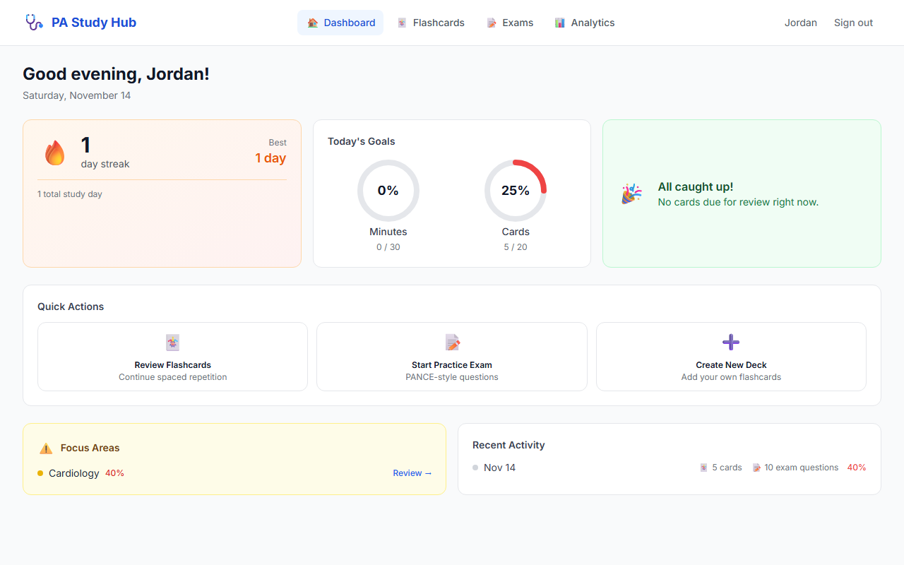
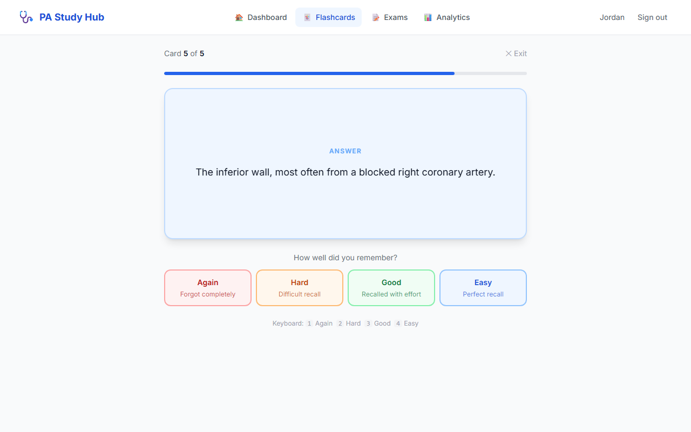
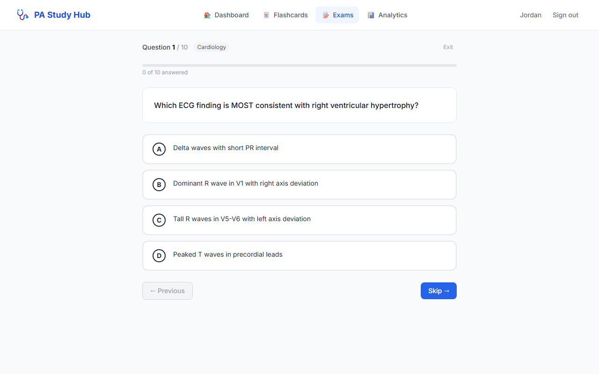
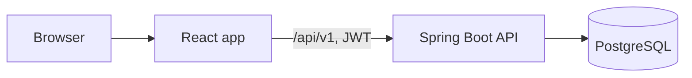

# PA Study Hub

[](https://github.com/SamaadTurner/pa-study-hub/actions/workflows/ci.yml)

A study app for physician assistant (PA) students: flashcards with spaced repetition,
timed practice exams in the style of the PANCE board exam, and a dashboard that tracks
streaks, daily goals and accuracy by topic.

**Try it: https://pa-study-hub.onrender.com** (register any email). It runs on free
plans, so after 15 minutes without visitors the server sleeps and the first page takes
about a minute to wake it up.

Spring Boot 3.2 (Java 17) and PostgreSQL 15 on the backend, React 18 with TypeScript on
the frontend. 315 backend tests, 92 frontend unit tests and 52 end-to-end browser tests
run in CI on every push.



## What it does

- **Flashcard decks.** Create decks and cards, filed under 17 topics from the NCCPA
  exam blueprint (cardiology, pharmacology, and so on). Decks can be private or public.
- **Spaced repetition.** Studying a deck shows the cards that are due. You flip a card
  and rate it Again, Hard, Good or Easy, and the SM-2 algorithm decides when it comes
  back (see [How cards are scheduled](#how-cards-are-scheduled)).
- **Public decks.** Search every public deck by title or description, filter by topic,
  and copy one into your own decks.
- **Practice exams.** Pick a topic, 5 to 30 questions and an optional time limit. You
  can skip and go back, and a reload keeps your answers and the time left. Right and
  wrong answers are only shown at the end, like the real exam, with an explanation for
  every question.
- **Progress.** Daily goals for cards and minutes, a study streak, and an analytics page
  with 30 days of activity and accuracy by topic. Flashcards and exams both count.
- **Optional AI help.** Paste notes and get suggested flashcards to review and edit
  before saving, or ask why your answer to an exam question was wrong. Off unless the
  server has an API key (see [AI features](#ai-features)).

| Studying a card | A practice exam question |
|---|---|
|  |  |

The app comes with 3 public decks and 30 practice questions (10 each for cardiology,
pharmacology and pulmonology). Exams in other topics say there are not enough questions.

## Run it

### With Docker

Needs Docker with Compose.

```bash
git clone https://github.com/SamaadTurner/pa-study-hub.git
cd pa-study-hub
cp .env.example .env
# Set JWT_SECRET in .env to 32 or more random characters, e.g. openssl rand -hex 32
docker compose up --build
```

Open http://localhost:3000 and register an account. The first start takes a few
minutes while the images build. CI runs these same steps on every push and registers
a user through port 3000, so this setup is tested.

### Without Docker

Needs JDK 17, Node 20 and a PostgreSQL 15 database. The backend creates its tables
on first start.

```bash
# Backend on http://localhost:8080 (API docs at /swagger-ui.html)
DB_NAME=pa_study_hub DB_USER=postgres DB_PASSWORD=postgres \
SPRING_PROFILES_ACTIVE=dev ./gradlew :app:bootRun

# Frontend on http://localhost:5173, in a second terminal
cd frontend
npm install
npm run dev
```

`DB_HOST` and `DB_PORT` default to `localhost` and `5432`. The `dev` profile is for your
own machine only: it creates a demo account (`demo@example.com` / `DemoStudent1!`) and
uses a built-in JWT secret. Without it there is no demo account, and the backend will
not start until `JWT_SECRET` is set.

## Tests

```bash
# Backend tests on an in-memory H2 database, then the coverage check
./gradlew :app:test :app:jacocoTestCoverageVerification

# The same tests against PostgreSQL, with the schema built by the real migrations.
# This wipes the database, so point it at an empty one.
TEST_DATABASE=postgres TEST_DB_URL=jdbc:postgresql://localhost:5432/pa_study_hub_test \
TEST_DB_USERNAME=postgres TEST_DB_PASSWORD=postgres ./gradlew :app:cleanTest :app:test

# Frontend unit tests and lint
cd frontend && npm test && npm run lint

# End-to-end tests in Chromium. Only PostgreSQL has to be running: the tests start
# the backend and the frontend themselves (DB_* variables as above).
cd frontend && npx playwright install chromium && npm run e2e
```

- **Backend:** 315 tests. Unit tests for the scheduling, scoring and streak logic, and
  integration tests that call the API through Spring's MockMvc. CI runs them twice, on
  H2 and on PostgreSQL 15 with the Flyway migrations, so the SQL is tested too.
  They cover 97.3% of lines and 82.0% of branches (JaCoCo, without the code Lombok
  generates). The build fails below 95% and 78%.
- **Frontend:** 92 unit tests with Vitest and React Testing Library.
- **End to end:** 52 Playwright tests that click through the real app: accounts, decks
  and cards, studying, exams (including the timer running out), public decks,
  analytics, the AI buttons (with the model's answers faked), and lists of more than 100
  decks and cards.
- **CI** has four jobs: backend tests, frontend tests with lint and build, end-to-end
  tests, and a Docker Compose run of the whole stack.

## How it is built



One Spring Boot application with a package per area (`user`, `flashcard`, `exam`,
`progress`) and one PostgreSQL database. The React app talks to it over a REST API at
`/api/v1`. In development Vite forwards `/api` to the backend, and in Docker nginx does.

```
app/                     Spring Boot backend
  src/main/java/com/pastudyhub/
    user/                accounts, login, JWT
    flashcard/           decks, cards, scheduling (SM-2)
    exam/                questions, exams, scoring
    progress/            activity log, streaks, goals, analytics
  src/main/resources/db/migration/   Flyway SQL migrations
frontend/                React + TypeScript + Vite + Tailwind
  src/pages/             one folder per area
  e2e/                   Playwright tests
docker-compose.yml       PostgreSQL, backend and nginx with the frontend
```

### How cards are scheduled

Each card keeps an interval (days until it is due), a repetition count and an ease
factor that starts at 2.5. The four buttons send a quality from 1 to 5: Again is 1,
Hard 2, Good 4 and Easy 5. With 3 or more, the card comes back after 1 day, then 6
days, then the last interval times the ease factor. Below 3, it starts over at 1 day.
The ease factor goes up after an easy answer and down after a hard one, never below
1.3. This is the SM-2 algorithm from SuperMemo, the same idea Anki started from. The
code is in `SpacedRepetitionEngine.java`.

There is also **FSRS-6**, the newer scheduler Anki offers since 2023. Instead of an ease
factor it tracks each card's *stability* (days until the chance of remembering drops to
90%) and *difficulty*, and plans the next review for the day that chance reaches the
target (90% by default). `FsrsEngine.java` is a port of the official TypeScript
implementation (ts-fsrs), and its tests compare every step of several review sequences
with numbers printed by that implementation.

Both schedulers run on every review and keep their own numbers, and every review is
logged (`review_logs`). `SCHEDULING_ALGORITHM=sm2` or `fsrs` decides whose date is used,
so switching never loses a card's history. FSRS has been the default since it was
measured against SM-2 on real review histories (results below).

### Comparing the schedulers

`src/evaluation` is a small command-line tool (kept out of the app's jar) that replays
review histories and scores both schedulers the way the public
[spaced-repetition benchmark](https://github.com/open-spaced-repetition/srs-benchmark)
does. Before every review except a card's first, each scheduler predicts the chance the
card is remembered; then it is shown the real rating (anything but Again counts as
remembered). Three scores come out:

- **Log loss:** how surprised the scheduler was on average. Lower is better.
- **RMSE (bins):** calibration. Predictions are grouped in 10% bins and each bin's average
  prediction is compared with how often those cards really were remembered. Lower is better.
- **AUC:** ranking only. 0.5 is guessing, 1 is perfect.

FSRS predicts recall directly. SM-2 only picks intervals, so to score it the tool assumes
what SM-2 aims for: 90% recall on the day its interval ends, falling off exponentially
(`0.9 ^ (days / interval)`). SM-2's scores depend on that assumption.

```bash
# reviews.csv has a header and the columns card_id,day,rating (rating 1 to 4)
./gradlew :app:evaluateSchedulers --args="path/to/reviews.csv"
```

**Results (2026-11-15).** The data is 10 users from the public
[anki-revlogs-10k](https://huggingface.co/datasets/open-spaced-repetition/anki-revlogs-10k)
dataset: 507,273 Anki reviews of 88,156 cards, of which 298,661 reviews could be predicted
(the first review of each card, and extra reviews on the same day, are skipped). The
dataset's license does not allow sharing the data, so only the scores are here. FSRS uses
its default parameters, not ones fitted to each user.

| Scheduler | Log loss | RMSE (bins) | AUC |
|---|---|---|---|
| SM-2 | 1.217 | 0.288 | 0.558 |
| FSRS-6 | **0.557** | **0.108** | **0.749** |

FSRS is better on all three across the pooled reviews. AUC is the fairest of the three for
SM-2, because it only depends on the order of the predictions, so it does not rest on the
90% assumption above; SM-2 is only a little better than guessing at telling which cards
will be forgotten. Scored user by user, FSRS has the better log loss and RMSE for 8 of the
10 users and the better AUC for 9 of 10. For the two users where SM-2 did slightly better,
FSRS with parameters fitted to their own history would be the next thing to try.

## Decisions

**From six services to one app.** The first version was six Spring Boot services
(gateway, users, flashcards, exams, progress and an AI assistant) with five databases.
For one app with a handful of users that was mostly overhead: features that crossed two
services needed HTTP calls between them and could not share a transaction. In July 2026
I merged them into one application with one database. One of those HTTP calls survived
the merge and pointed at a service that no longer existed, so reviews never reached the
streak counter until I replaced it with a plain method call in the same transaction.
The packages still follow the old service lines, so splitting one out later would be
possible.

**JWT with refresh tokens.** Access tokens last 15 minutes and are checked without a
database lookup. Refresh tokens are stored, work once, and are replaced on every use.
If an old one is used again, every token of that account is revoked, because that
usually means someone copied it. Changing the password revokes the refresh tokens too.

**Tests against real PostgreSQL.** The H2 run is fast, but H2 builds its tables from the
Java classes and never runs the migration files. On PostgreSQL the schema comes from the
migrations and Hibernate checks at startup that every class matches its table, so a
migration that does not fit the code fails CI.

**Exams are stored question by question.** The questions an exam picked are saved when it
starts, in order, with the order of their answer options fixed per exam. That is what lets
a reload, the results page and the history all show the same exam.

**Hosting on free plans.** The backend runs on Render's free plan from the Dockerfile and
the frontend is a Render static site (`render.yaml`). The static site passes `/api` on to
the backend, so the browser only talks to one address and the backend needs no CORS
setup. The database is a free Neon PostgreSQL in the same region (Oregon), because
Render's free database is deleted after 30 days. The cost of free is the one-minute wake-up
after an idle period; the app tells the user the server is starting instead of showing an
error.

## AI features

Two optional features use a language model: **Suggest cards** on a deck's page turns
pasted notes into up to 10 suggested cards, and **Explain my mistake** on the exam results
page explains one question, including why the option you picked was wrong.

- **Provider:** [Groq](https://console.groq.com)'s free tier with the `openai/gpt-oss-120b`
  model (no credit card, about 1,000 requests a day in November 2026). The backend talks to
  any OpenAI-compatible API, so Google Gemini or a local Ollama model work by changing
  `AI_BASE_URL` and `AI_MODEL`.
- **Off by default.** Without `AI_API_KEY` the status endpoint says so and the buttons are
  hidden. CI never calls a real model: the tests use a fake one.
- **A person checks the output.** Suggested cards are not saved until you keep them, and
  every AI answer on screen says it can be wrong. The prompts tell the model to use only
  the facts in your notes, or in the question's own teaching note.
- **Daily limits** so a free key can't be used up: 20 requests per user and 300 for the
  whole site per UTC day (`AI_DAILY_LIMIT_PER_USER`, `AI_DAILY_LIMIT_TOTAL`), counted in the
  database. A request that fails validation costs nothing.

To turn it on locally, add `AI_API_KEY=<your Groq key>` to the backend command above, or to
`.env` for Docker.

## Known limits

- The time limit is enforced by the page, not the server. An exam that never calls
  "finish" stays open.
- Signing out clears the tokens in the browser but does not revoke the refresh token on
  the server, so it stays valid for up to 7 days.
- There is no page for editing your profile or changing your password yet. The API for
  both exists and is tested.
- Only 30 practice questions, in three topics.

## License

[MIT](LICENSE)
