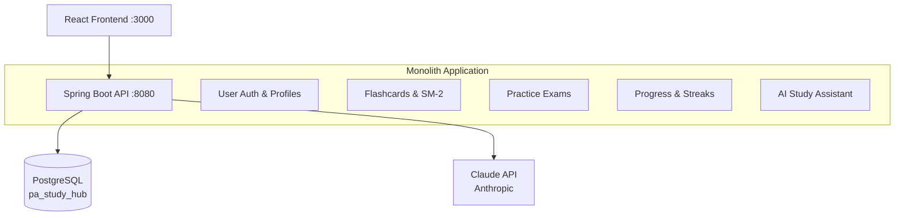

# PA Study Hub

> A spaced-repetition study platform for PA school students

[](https://openjdk.org/projects/jdk/17/)
[](https://spring.io/projects/spring-boot)
[](https://react.dev/)
[](https://www.typescriptlang.org/)
[](https://www.postgresql.org/)
[](https://www.docker.com/)
[](https://github.com/features/actions)

Built for Jocelyn, who starts PA school this spring. This app provides everything she needs to master the NCCPA content blueprint: spaced-repetition flashcards, timed practice exams, streak tracking, and AI-powered study assistance via the Claude API.

---

## Architecture



## Features

- [x] **Spaced-Repetition Flashcards** — SM-2 algorithm with Again/Hard/Good/Easy ratings
- [x] **Practice Exams** — Timed PANCE-style clinical vignette questions with detailed explanations
- [x] **Study Streak Tracking** — Daily goal progress, streak calendar, longest streak
- [x] **Performance Analytics** — Accuracy by category, trend charts, weakest area identification
- [x] **AI Flashcard Generator** — Paste lecture notes, get flashcards from Claude AI
- [x] **AI Wrong Answer Explainer** — Personalized explanations for missed exam questions
- [x] **AI Study Plan** — 7-day personalized study schedule based on your performance data
- [x] **AI Study Chat** — Conversational PA school tutor available 24/7
- [x] **NCCPA Blueprint Categories** — Organized by Cardiology, Pharmacology, Neurology, and 14 more
- [x] **Public Deck Sharing** — Browse and clone decks created by other users

## Prerequisites

- Java 17+ (for local development without Docker)
- Node.js 20+ (for local frontend development)
- Docker Desktop with Docker Compose
- PostgreSQL 15 (if running without Docker)

## Quick Start (Docker — Recommended)

```bash
# 1. Clone the repo
git clone https://github.com/yourusername/pa-study-hub.git
cd pa-study-hub

# 2. Set up environment variables
cp .env.example .env
# Edit .env and fill in:
#   - JWT_SECRET (32+ random characters)
#   - ANTHROPIC_API_KEY (from console.anthropic.com)
#   - Database password (or use the default)

# 3. Start everything
docker-compose up -d

# 4. Wait for services to be healthy (~60 seconds on first run)
docker-compose ps

# 5. Open the app
open http://localhost:3000

# Default seed user credentials:
# Email: jocelyn@pastudyhub.com
# Password: PAStudent2026!
```

## Running Locally (Without Docker)

Create the PostgreSQL database:

```sql
CREATE DATABASE pa_study_hub;
```

Start the backend:

```bash
# Backend API
./gradlew :app:bootRun

# API will be available at http://localhost:8080
# Swagger UI at http://localhost:8080/swagger-ui.html
```

Start the frontend:

```bash
# Frontend (separate terminal)
cd frontend
npm install
npm run dev
# Opens on http://localhost:3000
```

## Running Tests

```bash
# All backend tests
./gradlew test

# Backend tests with coverage report
./gradlew jacocoTestReport
# Open: app/build/reports/jacoco/test/html/index.html

# Frontend unit tests
cd frontend && npm test

# Frontend tests with coverage
cd frontend && npm test -- --coverage --watchAll=false

# E2E tests (app must be running)
cd frontend && npx cypress run
# or interactive mode:
cd frontend && npx cypress open
```

## Code Coverage

JaCoCo code coverage is enforced at 80% minimum line coverage. To view reports:

```bash
./gradlew jacocoTestReport
# Report at: app/build/reports/jacoco/test/html/index.html
```

## API Documentation

Swagger UI is available at:

- **All endpoints:** http://localhost:8080/swagger-ui.html

## Deployment

- **Render (Recommended for Portfolio):** See [DEPLOYMENT.md](DEPLOYMENT.md) - Free tier available
- **Fly.io:** See [FLY-DEPLOYMENT.md](FLY-DEPLOYMENT.md)

**Quick Deploy to Render:**
1. Push code to GitHub - See [GITHUB-SETUP.md](GITHUB-SETUP.md)
2. Connect Render to your repo
3. Add environment variables (JWT_SECRET, ANTHROPIC_API_KEY)
4. Deploy! (~5 minutes)

## Project Structure

```
pa-study-hub/
├── app/                      Spring Boot monolith (port 8080)
│   ├── src/main/java/com/pastudyhub/
│   │   ├── flashcard/        Decks, cards, SM-2 algorithm
│   │   ├── exam/             Practice exams, scoring
│   │   ├── progress/         Streaks, goals, analytics
│   │   ├── user/             Auth, JWT, profiles
│   │   ├── ai/               Claude API integration
│   │   ├── config/           OpenAPI, security configuration
│   │   └── exception/        Global exception handling
│   └── src/main/resources/
│       ├── db/migration/     Flyway SQL migrations
│       └── application.yml   App configuration
├── frontend/                 React + TypeScript + Tailwind (port 3000)
├── deploy/                   Deployment configs
├── seed/                     Starter flashcard decks and exam questions
├── docs/                     Architecture, API contracts, data models
├── docker-compose.yml        Full local orchestration
└── .github/workflows/ci.yml  GitHub Actions CI/CD pipeline
```

## Design Decisions

**Why a monolith?** Simplified deployment and development. All features share a single database and codebase, making it easier to maintain consistency, enforce foreign key constraints across domains, and deploy to free-tier hosting platforms. Perfect for a portfolio project and early-stage applications.

**Why the SM-2 algorithm?** It's the scientifically-validated spaced repetition algorithm used in Anki and SuperMemo, proven over decades. The key insight is that ease factors and intervals are calculated per-card per-user, so the algorithm adapts to Jocelyn's specific strengths and weaknesses.

**Why JWT?** Stateless authentication means no server-side sessions. The backend validates the JWT once and extracts user identity for each request. This keeps the app horizontally scalable and works well with modern frontend frameworks.

**Why a single database?** Enforces referential integrity across domains with foreign keys. Simpler migrations, easier to reason about data relationships, and better transaction support for cross-domain operations.

**Why Claude API for AI features?** Claude produces the best structured JSON output for flashcard generation, writes the most nuanced medical explanations, and handles conversational context well for the study tutor feature. The official Anthropic Java SDK provides a typed interface to the API.

## The SM-2 Algorithm

PA Study Hub implements the SuperMemo 2 (SM-2) algorithm for spaced repetition. See [docs/sm2-algorithm.md](docs/sm2-algorithm.md) for a full explanation.

In short: each card has an ease factor (default 2.5) and an interval (days until next review). After each review, you rate your recall quality 1-5. The algorithm adjusts the interval and ease factor so easy cards come back less often and hard cards come back more often.

## AI Features

PA Study Hub uses the Anthropic Claude API for four study assistance features:

1. **Flashcard Generator** — Paste lecture notes → get PANCE-targeted flashcards in seconds
2. **Wrong Answer Explainer** — After missing an exam question, get a personalized explanation of the misconception and a mnemonic to remember the correct answer
3. **Study Plan Recommender** — Based on your performance analytics, Claude generates a 7-day study schedule prioritizing your weakest areas
4. **Study Chat** — Ask Claude anything about your PA school coursework; it responds at PANCE-exam level with clinical reasoning

Prompts are externalized in `app/src/main/resources/prompts/system-prompts.json` for easy tuning.

Token usage is tracked per-user with a configurable daily budget (default: 50,000 tokens/day) to control API costs.

## Future Improvements

- [ ] Mobile app (React Native) — study on the go between classes
- [ ] PDF/image upload for AI flashcard generation from lecture slides
- [ ] Study groups — shared decks, collaborative exam prep
- [ ] Push notification reminders at preferred study time
- [ ] PANCE score predictor based on practice exam trends and content areas
- [ ] Voice-based flashcard review for hands-free commute studying
- [ ] Offline mode with background sync

## Built With

This project was developed using **Claude AI (Anthropic)** as both a development tool (Claude Code CLI for code generation and debugging) and as an integrated product feature (Claude API for AI-powered study assistance). This demonstrates proficiency in leveraging AI tools to accelerate development and building AI-powered features into production software.

## License

[MIT](LICENSE) — © 2026 Samaad Turner
